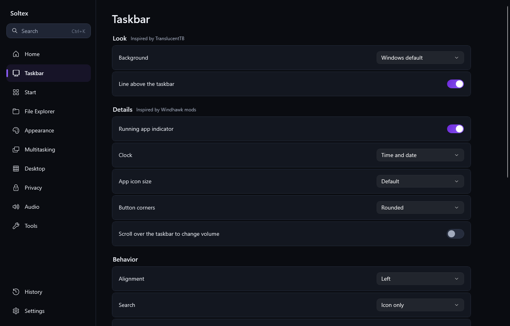
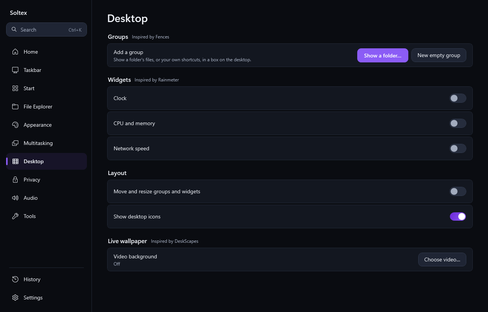
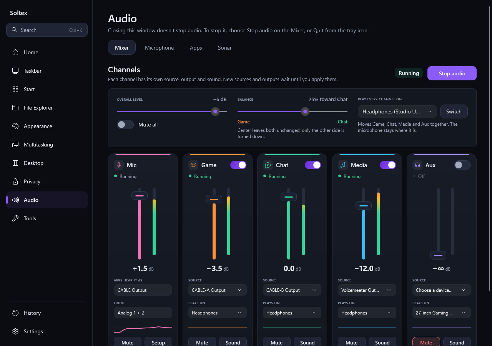

<p align="center">
  
</p>

<h1 align="center">Soltex</h1>

<p align="center">
  A quieter, cleaner Windows 11, in one small app. Every change can be undone.
</p>

<p align="center">
  <a href="https://github.com/celubos/soltex/actions/workflows/windows.yml"></a>
  <a href="https://github.com/celubos/soltex/releases/latest"></a>
  <a href="https://github.com/celubos/soltex/releases"></a>
  <a href="LICENSE.txt"></a>
  
</p>

<p align="center">
  <a href="https://github.com/celubos/soltex/releases/latest"><b>Download</b></a> ·
  <a href="#features">Features</a> ·
  <a href="#building-from-source">Build</a>
</p>

<p align="center">
  
</p>

Soltex turns off the ads, tips and tracking in Windows, restyles the taskbar, adds desktop groups and widgets, and puts a set of everyday tools and an audio mixer in the same place. It runs quietly from the tray, uses almost no CPU while idle, and keeps a history of every change so you can put Windows back the way it was.

## Features

**De-Windows**
- One click turns off ads, suggestions, tips, web results in search and diagnostic extras, about 30 Windows settings in all.
- **Full De-Windows** (asks for administrator) also turns off telemetry services and tasks, Copilot and Recall, and can remove OneDrive, Edge, News, Weather and other built-in apps. Each item is listed before anything changes.
- Update control: Windows asks before downloading updates and never restarts while you are signed in. Defender, the firewall, UAC and Windows Update itself are never turned off.

**Taskbar**, inspired by [TranslucentTB](https://github.com/TranslucentTB/TranslucentTB) and [Windhawk](https://github.com/ramensoftware/windhawk) mods
- A look for each state, as in TranslucentTB: on the desktop, while a window is visible or maximized, while Start, Search or Task View is open, and in battery saver. Each look is Windows default, opaque, clear, blur or acrylic, with its own color and opacity.
- With several displays, each taskbar follows what happens on its own display, so a maximized window on one screen changes only that screen's taskbar.
- Hide the running-app line, choose what the clock shows, larger or smaller icons, square button corners.
- Scroll over the taskbar to change the volume.

**Desktop**, inspired by Fences and Rainmeter
- Groups that show a folder or your own shortcuts, stay on the desktop through Win+D, and roll up when you don't need them.
- Clock, CPU and memory, and network speed widgets.
- A video as your wallpaper, paused while a window is maximized.

**Tools**, inspired by [PowerToys](https://github.com/microsoft/PowerToys)
- Text extractor (Win+Shift+T): copy the text in any part of the screen.
- Window zones: hold Shift while dragging a window and drop it into a zone.
- Batch rename with a preview and undo, key remapping, always on top, color picker and keep awake.
- Startup apps: choose what starts when you sign in.

**Audio**
- A five-channel mixer (Mic, Game, Chat, Media, Aux) with a game and chat balance, and a separate stream mix.
- Microphone setup in a few steps, with a 10-second test that tells you which input your voice arrives on.
- **AI noise removal** ([RNNoise](https://github.com/xiph/rnnoise) by Xiph): keyboards, clicks, fans and room noise drop away while your voice stays, with a strength setting.
- A **curve equalizer**: drag ten points to shape your voice (frequency, level and width per band), with bell, shelf, cut and notch shapes. You hear every change while you make it.
- Microphone chain with noise gate, compressor, steady-noise suppression and an optional safety limiter that catches peaks.
- Audio passed between two devices is converted with a high-quality resampler that also corrects the drift between their clocks, so it does not slowly fall behind or drop out.
- Per-app volume and output device.

**And also**
- Start, File Explorer, Appearance and Multitasking settings in plain words, plus automatic dark mode by time of day, pointer schemes and folders next to the power button.
- **History** lists every change, and each one can be undone.
- If a Windows update turns something back on, Soltex tells you and offers to put it back.
- Export your whole setup to a file and import it on another PC.
- Search everything with Ctrl+K.
- Fits a small window: the page list shrinks to an icon rail and pages reflow.

<p align="center">
  
  
</p>

## Installation

1. Download **`Soltex-<version>-win-x64-setup.exe`** from the [latest release](https://github.com/celubos/soltex/releases/latest).
2. Run it. It installs for your account only, so no administrator rights are needed. On a first install it offers to start Soltex when you sign in; after that, the switch in Soltex's Settings decides, and upgrades leave it as it is.
3. Open **Soltex** from the Start menu.

Prefer not to install? Download `Soltex-<version>-win-x64.zip` instead, unzip it anywhere and run `Soltex.exe`.

Soltex is not code-signed yet, so Windows SmartScreen may say it "protected your PC". Choose **More info › Run anyway**. Each release lists SHA-256 checksums in `SHA256SUMS.txt` so you can check your download.

To uninstall:

1. Undo any changes you want reversed in **History**.
2. If you changed the taskbar look, open **Taskbar** in Soltex, set the look to **Windows default** and turn off the taskbar details you turned on. Otherwise the taskbar keeps its look until you sign out or restart.
3. Remove Soltex from **Settings › Apps › Installed apps**. The uninstaller quits Soltex first. If Soltex asks whether to stop your audio, choose **Quit**; if you choose Cancel or do not answer within 20 seconds, the uninstall stops without removing anything.

Your settings stay in `%LOCALAPPDATA%\Soltex` and the registry key `HKCU\Software\Soltex`, so a reinstall keeps them. To remove them too, sign out or restart first (the taskbar helper stays loaded in File Explorer until then), then delete that folder and that key.

If you used **Full De-Windows**, its change history stays in `%ProgramData%\Soltex\System`, so a reinstalled Soltex can still undo those changes. Deleting that folder needs administrator rights, and afterwards Soltex can no longer undo the Full De-Windows changes; undo them first if you want them reversed.

### System requirements

- Windows 11, x64. Most settings also work on Windows 10 version 2004 or later; the taskbar look needs Windows 11.
- No administrator rights, except for Full De-Windows, which asks when you run it.

## Usage

- Soltex lives in the tray. Closing the window keeps it running; choose **Quit** from the tray icon to exit.
- Press **Ctrl+K** in the window to find any setting.
- Everything is off until you turn it on. To undo a change, open **History**.
- Settings are stored in `%LOCALAPPDATA%\Soltex`; the history of Full De-Windows (administrator) changes is in `%ProgramData%\Soltex\System`.

## Building from source

You need Windows 10 or 11 (x64) and the [.NET 10 SDK](https://dotnet.microsoft.com/download/dotnet/10.0), version 10.0.3xx (see `global.json`).

```powershell
git clone https://github.com/celubos/soltex.git
cd soltex
dotnet build Soltex.sln -c Release
dotnet run --project src/Soltex.App
```

The taskbar look uses a small native helper built with LLVM-MinGW. `native\Soltex.TaskbarStyle\build.ps1 -Acquire` downloads the pinned toolchain, checks its hash and builds it. See [docs/BUILDING.md](docs/BUILDING.md) for the tests and the release package.

## Contributing

Bug reports and pull requests are welcome. Please read [CONTRIBUTING.md](CONTRIBUTING.md) first. To report a security problem, see [SECURITY.md](SECURITY.md).

## Privacy

Soltex has no telemetry, no account and no ads. It does not send anything about you anywhere. When you choose **Check now** for updates, Windows' own update service does the checking; the optional Sonar view talks only to SteelSeries Sonar on your own PC.

## Acknowledgements

- [TranslucentTB](https://github.com/TranslucentTB/TranslucentTB), [Windhawk](https://github.com/ramensoftware/windhawk), [PowerToys](https://github.com/microsoft/PowerToys), Stardock Fences and Start11, [Rainmeter](https://github.com/rainmeter/rainmeter) and Winaero Tweaker inspired many of the features. Soltex contains none of their code.
- [NAudio](https://github.com/naudio/NAudio) for audio device access.
- [LLVM-MinGW](https://github.com/mstorsjo/llvm-mingw) for building the taskbar helper.

## License

Soltex is free and open source under the [MIT License](LICENSE.txt).

Soltex is not affiliated with Microsoft, SteelSeries or any project named above. It changes Windows settings; every change is recorded and can be undone from History.
